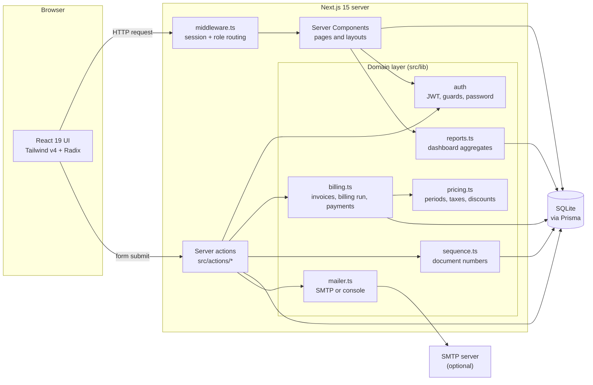
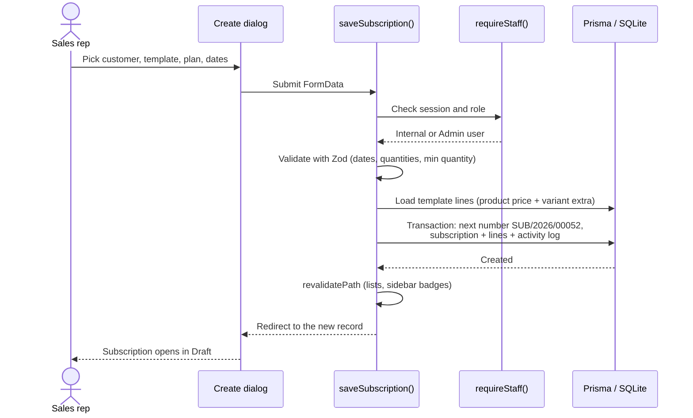
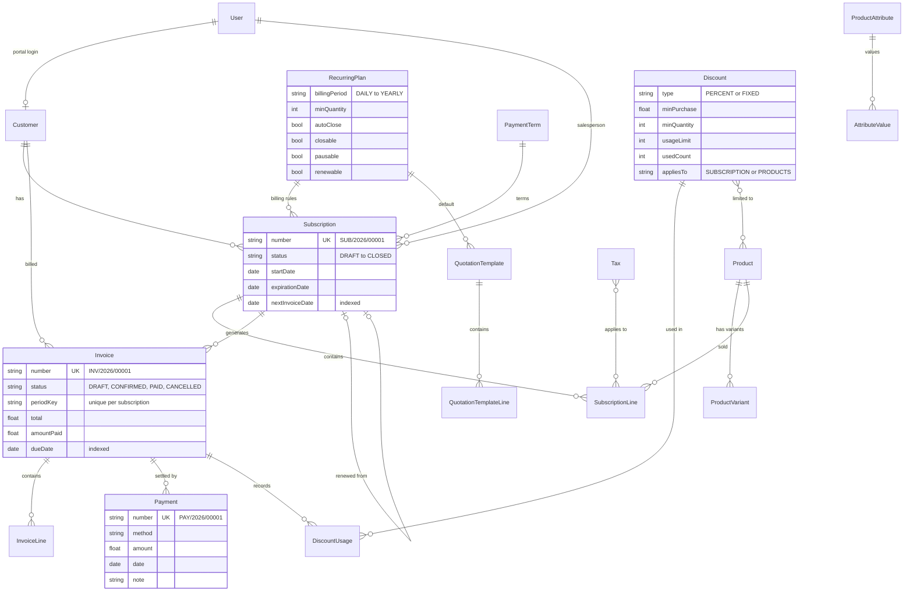
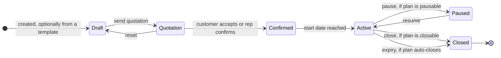
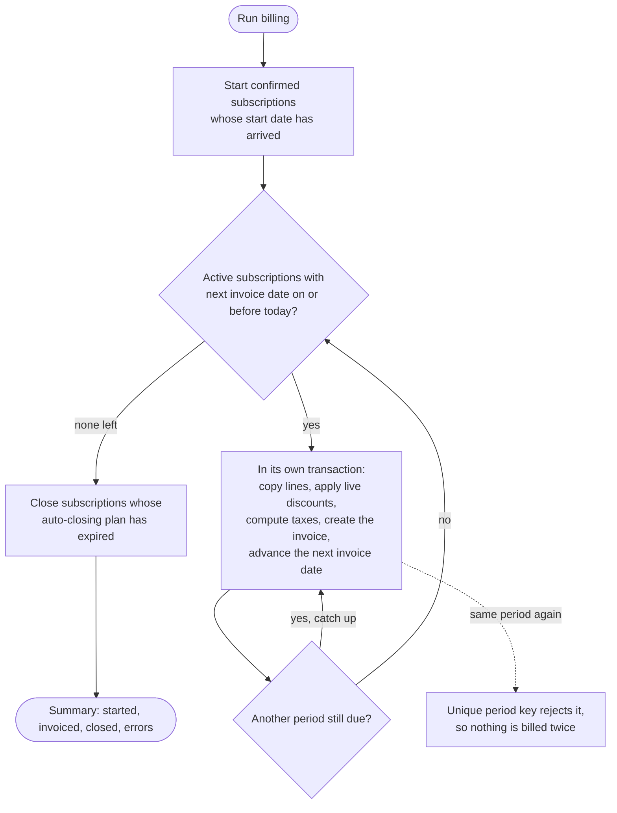
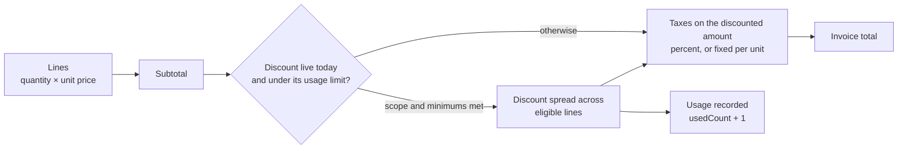
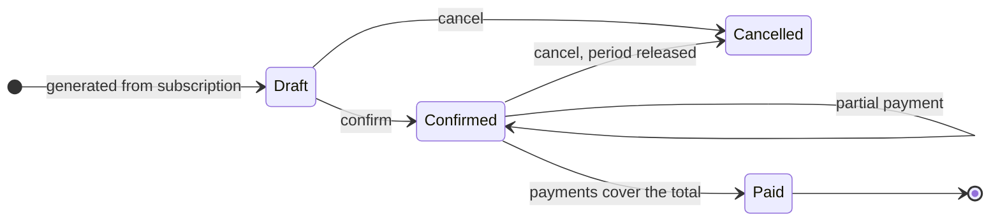

<div align="center">

# Brightloop Subscriptions

**One system for plans, subscriptions, recurring billing, payments and revenue reporting.**

An Odoo-style subscription management platform for **Brightloop Software**, built for the _Subscription Management System_ challenge.

</div>

---

## The problem

Brightloop sells everything on subscription. Today its subscriptions live in a spreadsheet, renewals are remembered by whoever notices, invoices are typed by hand, payments are matched by scrolling bank statements, and revenue reports take days.

| Before                                   | With Brightloop Subscriptions                                                              |
| ---------------------------------------- | ------------------------------------------------------------------------------------------ |
| Subscriptions tracked in a spreadsheet   | Every subscription has a number, a status and a full activity history                      |
| Renewals remembered by whoever notices   | Expiring subscriptions are flagged; plans can renew or close on their own                  |
| Invoices typed up by hand every month    | One billing run creates every due invoice, with taxes and discounts                        |
| Payments matched by scrolling statements | Payments are recorded against invoices; outstanding and overdue amounts are always visible |
| Revenue reports built every quarter      | A live dashboard with MRR, revenue, payments and overdue invoices                          |

## What it does

| Area                    | Highlights                                                                                                                                                                                            |
| ----------------------- | ----------------------------------------------------------------------------------------------------------------------------------------------------------------------------------------------------- |
| **Accounts and roles**  | Sign-up with a unique email, a strict password policy, password reset by emailed link, and three roles: Admin, Internal and Portal                                                                    |
| **Catalog**             | Products with type, sales and cost price, and notes. Attribute variants carry price extras (Brand: Odoo **+₹560**)                                                                                    |
| **Recurring plans**     | Daily, weekly, monthly or yearly billing, minimum quantity and availability dates. Each plan sets whether it auto-closes, can be closed, paused or renewed                                            |
| **Quotation templates** | A plan plus product lines and a validity period. Picking a template fills in a new subscription                                                                                                       |
| **Subscriptions**       | Draft → Quotation → Confirmed → Active → Closed, plus pause/resume, renewal, a next-invoice preview and an activity log                                                                               |
| **Invoicing**           | Generated from subscriptions, one per period, never twice, with missed periods caught up. Confirm, cancel, send, print or save as PDF                                                                 |
| **Taxes and discounts** | Admin-defined percentage or fixed taxes. Discounts can be fixed or percentage, with minimums, date windows and usage limits, scoped to products or whole subscriptions, and are applied automatically |
| **Payments**            | Method, amount, date and note against an invoice. Partial payments and overpayment protection                                                                                                         |
| **Customer portal**     | Customers see their own subscriptions and invoices, accept quotations, pay, pause, renew or close                                                                                                     |
| **Reporting**           | MRR/ARR, active subscriptions, invoiced vs collected, outstanding and overdue, MRR by plan and top customers, filtered by period and plan                                                             |
| **Interface**           | Collapsible sidebar with live badges, create dialogs, breadcrumbs, mobile drawer and a public landing page                                                                                            |

## Quick start

Requirements: **Node.js 20+**. Nothing else; the database is a local SQLite file.

```bash
npm install
cp .env.example .env
npm run setup      # create the database and load demo data
npm run dev        # http://localhost:3000
```

### Demo accounts

| Role     | Email                    | Password     | Lands on |
| -------- | ------------------------ | ------------ | -------- |
| Admin    | admin@brightloop.test    | Admin@1234   | `/home`  |
| Internal | staff@brightloop.test    | Staff@1234   | `/home`  |
| Internal | sales@brightloop.test    | Sales@1234   | `/home`  |
| Portal   | customer@brightloop.test | Customer@123 | `/my`    |

### Environment

| Variable       | Purpose                                          | Default                 |
| -------------- | ------------------------------------------------ | ----------------------- |
| `DATABASE_URL` | SQLite file used by Prisma                       | `file:./dev.db`         |
| `AUTH_SECRET`  | Signs session cookies. Use a long random string  | (none)                  |
| `APP_URL`      | Base URL used in emailed links                   | `http://localhost:3000` |
| `SMTP_*`       | Optional mail server for reset and invite emails | Printed to the console  |

When `SMTP_HOST` is empty, emails are printed to the server console, so password reset works fully offline.

---

## Architecture

Brightloop is a single Next.js application. Pages are React Server Components that read from the database directly, and every write goes through a **server action** that validates input with Zod, checks the user's role, and runs in a Prisma transaction. There is no separate API layer to keep in sync.



### Layers

| Layer                  | Where                              | Responsibility                                                                                                                                                                        |
| ---------------------- | ---------------------------------- | ------------------------------------------------------------------------------------------------------------------------------------------------------------------------------------- |
| **Routing and access** | `src/middleware.ts`                | Verifies the session cookie on every request. Sends signed-out users to `/login`, customers to `/my` and staff away from the portal                                                   |
| **Pages**              | `src/app/**/page.tsx`              | Server Components that query Prisma directly, paginate lists and render tables, forms and charts                                                                                      |
| **Writes**             | `src/actions/*.ts`                 | One file per domain. Each action calls a guard (`requireStaff`, `requireAdmin`, `requirePortal`), validates with Zod, writes in a transaction and revalidates the affected pages      |
| **Domain logic**       | `src/lib/billing.ts`, `pricing.ts` | Invoice generation, the billing run and payment registration. `pricing.ts` is pure and shared by server and client, so the order-line preview and the real invoice use the same maths |
| **Persistence**        | `prisma/schema.prisma`             | 21 models with unique constraints and indexes that enforce business rules at the database level                                                                                       |

### How a request flows

Creating a subscription from the **New** dialog:



Field errors come back from the action and show inline without clearing what the user typed.

---

## Data model



Rules the database itself enforces:

- **One account per email:** `User.email` is unique.
- **No double billing:** `Invoice(subscriptionId, periodKey)` is unique. Cancelling an invoice clears its `periodKey`, so that period can be billed again.
- **Gap-free numbering:** `SUB/`, `INV/` and `PAY/` numbers come from a `Sequence` table updated inside the same transaction as the record.
- **Fast filters:** status, customer, due date, invoice date, next invoice date and payment date are all indexed.

---

## Business workflows

### Subscription lifecycle



Renewing an active subscription creates a new, linked subscription. Every transition is checked against the plan's options and written to the record's activity log, so anyone on the team can see where a subscription stands and how it got there.

### Billing day

One click on **Run billing** (or a scheduled call to `runBilling()`) handles the whole month:



Running it twice on the same day creates nothing new. This is covered by an automated test.

### How an invoice is priced



### Invoice and payment lifecycle



An invoice is **overdue** when it is confirmed and its due date has passed. That is computed rather than stored, so it is always current. Payments larger than the amount still due are rejected.

---

## Roles and permissions

| Capability                                    | Admin |   Internal   |         Portal          |
| --------------------------------------------- | :---: | :----------: | :---------------------: |
| Dashboard and reports                         |  ✅   |      ✅      |                         |
| Customers, subscriptions, invoices, payments  |  ✅   |      ✅      |    Own records only     |
| Run billing; confirm, send or cancel invoices |  ✅   |      ✅      |                         |
| Products, attributes, plans, templates        |  ✅   | 👁 read-only |                         |
| Taxes, payment terms, discounts               |  ✅   | 👁 read-only |                         |
| Create staff users                            |  ✅   |              |                         |
| Accept quotations, pay, pause, renew, close   |       |              | ✅ when the plan allows |

Permissions are enforced on the server in two places: `middleware.ts` routes each role to its own area, and every server action calls a guard before touching data. Hiding a button is never the only protection. Internal users see a lock icon next to read-only items in the sidebar.

## Security

- **Passwords:** bcrypt hashes. The policy (more than 8 characters, upper case, lower case and a special character) is enforced on the server with Zod, and the sign-up form shows a live checklist.
- **Sessions:** HS256-signed JWT in an `httpOnly`, `sameSite=lax` cookie that is `secure` in production. Deactivated or deleted users are signed out on their next request.
- **Password reset:** tokens are stored only as hashes, expire, and can be used once. The response never reveals whether an email is registered.
- **Validation:** every form is validated on the server. Errors come back per field and the user's input is kept.
- **Data isolation:** every portal query is scoped to the signed-in customer.

---

## Tests and performance

```bash
npm test        # 18 tests on a throwaway prisma/test.db
npm run perf    # load test on a separate prisma/perf.db
```

Neither command touches your `dev.db`.

**Tests** cover the rules the brief spells out:

| Suite           | What it proves                                                                                           |
| --------------- | -------------------------------------------------------------------------------------------------------- |
| Password policy | More than 8 characters; upper case, lower case and special character required; exactly 8 is rejected     |
| Billing periods | Daily, weekly and yearly maths; 31 Jan + 1 month = 28 Feb                                                |
| Taxes           | Percentage and fixed taxes per line, applied after discounts                                             |
| Discounts       | Whole-subscription vs product scope, minimum quantity and purchase, fixed discounts capped at the amount |
| Billing day     | Every missed period is invoiced, a second run bills nothing, and auto-closing plans close                |
| Payments        | Overpayment is rejected, partial payments keep the invoice open, full payment marks it paid              |
| Discount limits | Stops after its usage limit; ignored outside its date window                                             |

**Performance.** The brief asks for every page to respond in under two seconds with thousands of subscriptions. `npm run perf` fills a database and times the queries behind each main page:

| Page                     | 5,000 subscriptions · 20k invoices | 20,000 subscriptions · 80k invoices |
| ------------------------ | ---------------------------------: | ----------------------------------: |
| Dashboard (all time)     |                              61 ms |                              231 ms |
| Subscriptions list       |                               2 ms |                                5 ms |
| Subscriptions search     |                               2 ms |                                7 ms |
| Invoices, overdue filter |                               1 ms |                                8 ms |
| Payments list            |                               0 ms |                                2 ms |

Why it stays fast: lists are paginated (40 rows) and counted in the database, dashboard figures are SQL aggregates rather than loops in JavaScript, and every column used for filtering or sorting is indexed.

---

## Project structure

```
prisma/
  schema.prisma          21 models, constraints and indexes
  seed.ts                realistic demo data (customers, plans, a year of invoices)
scripts/
  perf.ts                load test
tests/
  pricing.test.ts        pure pricing and policy rules
  billing.test.ts        billing run, payments and discount limits on a real database
src/
  middleware.ts          session check and role routing
  actions/               server actions, one file per domain
  app/
    page.tsx             public landing page
    (auth)/              login, signup, forgot and reset password
    (backend)/           staff app: home, dashboard, subscriptions, invoices,
                         payments, customers, products, config, users
    my/                  customer portal
    api/health/          health check (database ping)
  components/
    layout/              sidebar and top bar
    odoo/                list views, control panel, status bar, chatter, create dialogs
    charts/              revenue chart and bar lists
    landing/             landing page sections and hand-drawn accents
    ui/                  shadcn-style primitives on Radix
  lib/
    auth/                JWT sessions, guards, password policy
    billing.ts           invoice generation, billing run, payments
    pricing.ts           pure maths for periods, taxes and discounts
    reports.ts           dashboard aggregates
    sequence.ts          SUB/INV/PAY numbering
    nav.ts               role-based sidebar menus
```

## Requirements coverage

| From the brief                                                                  | Where                                                      |
| ------------------------------------------------------------------------------- | ---------------------------------------------------------- |
| Unique email, password rules, reset link by email                               | `lib/auth/password.ts`, `actions/auth.ts`, `lib/mailer.ts` |
| Admin, internal and portal roles; only admin adds staff                         | `middleware.ts`, `lib/auth`, `actions/users.ts`            |
| Products with type, prices, notes and variants (+560)                           | `(backend)/products`, `(backend)/config/attributes`        |
| Plans: period, minimum quantity, dates, close, pause, renew, auto-close         | `(backend)/config/plans`, `actions/subscriptions.ts`       |
| Quotation templates with validity                                               | `(backend)/config/templates`                               |
| Subscription number, lines and taxes; Draft → Closed                            | `(backend)/subscriptions`, `lib/sequence.ts`               |
| Invoices from subscriptions; confirm, cancel, send, print; nothing billed twice | `lib/billing.ts`, `(backend)/invoices`                     |
| Discounts: fixed or %, minimums, dates, limits, scope, applied automatically    | `(backend)/config/discounts`, `lib/pricing.ts`             |
| Payments with method, amount, date and note; outstanding and overdue            | `(backend)/payments`, `registerPayment()`                  |
| Finance view with filters and summary                                           | `(backend)/dashboard`, `lib/reports.ts`                    |
| Every page under two seconds with thousands of subscriptions                    | `npm run perf`, results above                              |

## Scripts

| Script              | Purpose                                    |
| ------------------- | ------------------------------------------ |
| `npm run dev`       | Start the dev server                       |
| `npm run build`     | Generate the Prisma client and build       |
| `npm run start`     | Serve the production build                 |
| `npm run typecheck` | Type-check the project                     |
| `npm run setup`     | Create the database and seed demo data     |
| `npm run db:seed`   | Reseed demo data                           |
| `npm run db:reset`  | Reset the database and reseed it           |
| `npm test`          | Run the test suite on a throwaway database |
| `npm run perf`      | Load-test with thousands of records        |

## Team

- Priyansh Narang
- Shivam Kharat
- Kaushal Loya
- Paarthu Reddy
